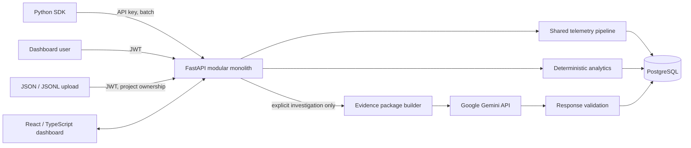

# Architecture

**Status:** Modular monolith and listed stack are **CONFIRMED**. Module boundaries and deployment details are **PROPOSED** unless stated otherwise.

## Goals and constraints

- Deliver a coherent Python-first MVP with limited development time.
- Keep telemetry capture and analytics independent of Gemini.
- Route SDK, JSON, and JSONL sources into one canonical pipeline.
- Enforce project isolation and reliable relationships.
- Avoid Kafka, Redis, Celery, Kubernetes, microservices, and other infrastructure without a concrete measured requirement.

## System context

Gemini has no database access. It receives only a backend-constructed, bounded evidence package after explicit user action and applicable consent/privacy controls. API, ingestion, and analytics remain functional if Gemini is unavailable.

## Proposed modular-monolith boundaries

| Module | Responsibility |
|---|---|
| Authentication/users | Registration, login, JWT issuance/verification, current user |
| Projects/API keys | Ownership, project CRUD, one-time key generation, hash validation/revocation |
| Ingestion | Authenticated SDK batch adapter and shared normalization/persistence service |
| Uploads | Authenticated owner-checked file parsing, limits, processing status |
| Telemetry | Canonical trace/span/event validation and project-safe persistence |
| Trace/events | Owner-scoped reads, filtering, pagination, tree/detail assembly |
| Analytics/insights | SQL/Python deterministic metrics and explainable rules |
| Investigations/reports | Evidence selection, Gemini adapter, schema validation, report persistence/history |

These are logical modules within one FastAPI application and PostgreSQL database, not independently deployed services. Shared dependencies (configuration, database session, error envelope) should be centralized without coupling domains unnecessarily.

## Telemetry flow

1. Authenticate: SDK API key; dashboard JWT for uploads and reads.
2. Resolve project from the API-key record for SDK; validate dashboard project ownership for uploads.
3. Parse source representation and check request/file limits and schema version.
4. Normalize into canonical trace/span/event records.
5. Validate IDs, parent relationships, timestamps, project associations, and constraints.
6. Apply the confirmed stable record-ID duplicate policy and persist the entire batch atomically; any conflict rolls back the batch.
7. Return structured processing status. Detailed sequencing and open decisions are in [Ingestion Pipeline](INGESTION_PIPELINE.md).

## Persistence

PostgreSQL is the system of record with JSONB attributes. The initial proposed schema has eight tables and is detailed in [Database Schema](DATABASE_SCHEMA.md). Alembic manages schema migrations. Upload files themselves have no selected object-storage service; [Deployment](DEPLOYMENT.md) and [Security](SECURITY.md) document the open storage/retention choices.

## Analytics and investigation boundary

Analytics are calculated deterministically from canonical telemetry. Provider/model pricing is backend-configured; unknown pricing is unavailable rather than guessed. Gemini is invoked only for explicit investigations. The backend selects relevant telemetry and metrics, removes/redacts data according to user controls, constrains context, validates output, and stores evidence references with the report.

## Technology

| Layer | Confirmed choice |
|---|---|
| Backend/API | Python, FastAPI, Pydantic |
| Persistence/migrations | SQLAlchemy ORM, Alembic |
| Database | PostgreSQL, JSONB |
| Frontend | React, TypeScript, Tailwind CSS, Recharts |
| SDK | Python package, manual instrumentation initially |
| AI investigations | Google Gemini API, on-demand only |
| Tests | pytest backend/SDK; frontend tooling selected at implementation |
| Phase 1 local development | Existing native PostgreSQL 18 instance on Windows; database `evalforge` managed by the owner through pgAdmin 4 |

## Quality attributes

- **Isolation:** owner checks and project-scoped query paths throughout.
- **Reliability:** bounded synchronous requests for MVP; idempotency and explicit failure reporting.
- **Performance:** batch SDK sends, bounded upload size, indexes on common project/time/trace lookups.
- **Privacy:** prompts/responses not captured by default; opt-in/redaction before any external model transfer.
- **Operability:** structured logs without secrets, health checks, migrations, documented configuration.
- **Maintainability:** focused domain modules, typed boundary schemas, tests for cross-module contracts.

## Known limitations and unresolved choices

No scale/SLO targets, retention, file-storage backend, transaction strategy for partial batch failures, pagination convention, rate limits, or deployment host are finalized. Keep synchronous processing until measurements or requirements justify a queue. See [ADRs](decisions/).
