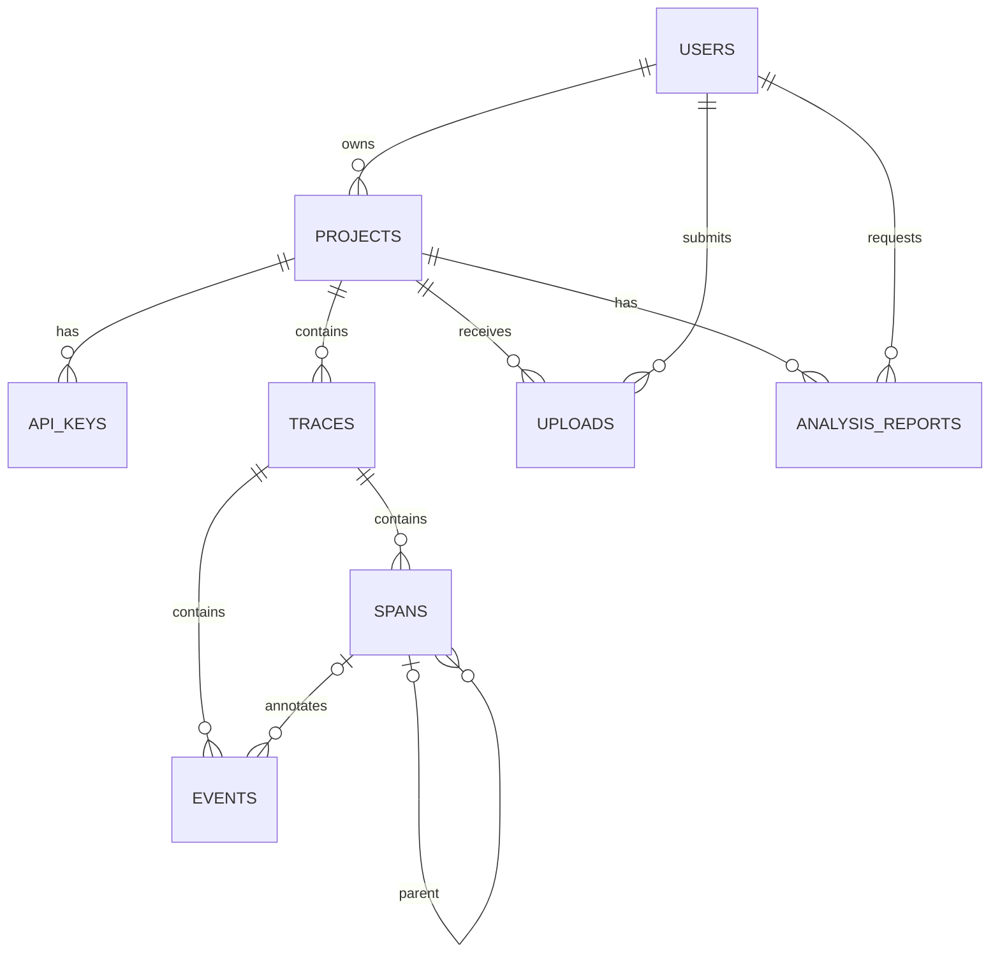

# Database Schema

**Status:** PostgreSQL and eight initial tables are **CONFIRMED** requirements. The columns and constraints below are a **PROPOSED initial design** requiring implementation-time review. This is documentation, not a migration or ORM model.

## Conventions

- UUID primary keys; UTC timestamps in `TIMESTAMPTZ`.
- PostgreSQL JSONB for extensible attributes and structured report content.
- `BIGINT` (or bounded integer) for duration and token counts; fixed-precision `NUMERIC` for money, paired with an explicit currency code.
- Use composite unique keys/FKs where needed to prevent cross-project relationships.
- `created_at` is server-generated. Exact update timestamps and deletion policy remain unresolved.

## Entity relationships

## Table definitions

### `users`

| Column | Type | Constraints / purpose |
|---|---|---|
| `id` | UUID | PK |
| `email` | VARCHAR(320) | NOT NULL; unique after defined canonicalization |
| `password_hash` | TEXT | NOT NULL; password-hashing output only |
| `created_at` | TIMESTAMPTZ | NOT NULL, server UTC |

Unique: `email`. Index: unique email index. Password reset, email verification, account status, and soft deletion are not yet designed.

### `projects`

| Column | Type | Constraints / purpose |
|---|---|---|
| `id` | UUID | PK |
| `owner_user_id` | UUID | NOT NULL FK `users.id` |
| `name` | VARCHAR(160) | NOT NULL |
| `description` | TEXT | nullable |
| `created_at` | TIMESTAMPTZ | NOT NULL |
| `updated_at` | TIMESTAMPTZ | NOT NULL |

Unique `(id, owner_user_id)` in addition to the primary key. This candidate key allows upload/report rows to reference the owner of their project as a pair. Index `owner_user_id`; optionally unique `(owner_user_id, name)` if product chooses that rule (UNRESOLVED). The MVP uses a single-owner project model; there is no team/multiple-owner model.

### `api_keys`

| Column | Type | Constraints / purpose |
|---|---|---|
| `id` | UUID | PK; public key record identifier |
| `project_id` | UUID | NOT NULL FK `projects.id` |
| `key_id` | VARCHAR(32) | NOT NULL; non-secret lookup identifier |
| `prefix` | VARCHAR(24) | NOT NULL; display-only prefix |
| `key_hash` | TEXT | NOT NULL; keyed/cryptographic hash, never plaintext |
| `created_at` | TIMESTAMPTZ | NOT NULL |
| `revoked_at` | TIMESTAMPTZ | nullable |
| `last_used_at` | TIMESTAMPTZ | nullable |

Unique: `key_id`, `key_hash`; index `(project_id, created_at)`, hash/identifier lookup. Generate high-entropy secret, return full secret once, store only a verification-safe hash and non-secret identifier/prefix. Hash algorithm/pepper rotation is **PROPOSED/UNRESOLVED**; key IDs enable lookup before constant-time verification.

### `traces`

| Column | Type | Constraints / purpose |
|---|---|---|
| `id` | UUID | PK |
| `project_id` | UUID | NOT NULL FK `projects.id` |
| `external_id` | VARCHAR(255) | nullable; source ID |
| `name` | VARCHAR(255) | NOT NULL |
| `status` | VARCHAR(32) | NOT NULL; extensible, not DB enum |
| `start_time`, `end_time` | TIMESTAMPTZ | NOT NULL |
| `duration_ms` | BIGINT | NOT NULL, CHECK `>= 0` |
| `environment`, `service_name` | VARCHAR(128) | nullable |
| `attributes` | JSONB | NOT NULL, default empty object |
| `created_at` | TIMESTAMPTZ | NOT NULL |

Explicit unique `(project_id, id)` to support composite FKs. This key is valid because both columns are non-null and PostgreSQL permits a referenced FK target backed by a unique constraint. Optional unique `(project_id, external_id)` only if external IDs are defined unique (UNRESOLVED). Indexes `(project_id, start_time DESC)`, `(project_id, status, start_time DESC)`, and `(project_id, external_id)` as query needs dictate.

### `spans`

| Column | Type | Constraints / purpose |
|---|---|---|
| `id` | UUID | PK |
| `project_id`, `trace_id` | UUID | NOT NULL; composite FK `(project_id, trace_id)` to `traces(project_id, id)` |
| `parent_span_id` | UUID | nullable; parent in same trace/project |
| `name` | VARCHAR(255) | NOT NULL |
| `operation_type`, `status` | VARCHAR(64), VARCHAR(32) | NOT NULL; extensible values |
| `start_time`, `end_time` | TIMESTAMPTZ | NOT NULL |
| `duration_ms` | BIGINT | NOT NULL CHECK `>= 0` |
| `provider`, `model` | VARCHAR(128), VARCHAR(255) | nullable |
| `input_tokens`, `output_tokens`, `total_tokens` | BIGINT | nullable, each CHECK `>= 0` |
| `estimated_cost` | NUMERIC(20, 10) | nullable, CHECK `>= 0`; amount in the proposed canonical reporting currency |
| `estimated_cost_currency` | VARCHAR(3) | nullable ISO 4217 code paired with `estimated_cost` |
| `attributes` | JSONB | NOT NULL, default empty object |
| `error_type`, `error_message` | VARCHAR(255), TEXT | nullable, sanitized |
| `created_at` | TIMESTAMPTZ | NOT NULL |

Declare `UNIQUE (project_id, trace_id, id)` on `spans`, in addition to the primary key on `id`. PostgreSQL requires the referenced columns of a composite foreign key to be covered by a primary key, unique constraint, or suitable non-partial unique index. This explicit three-column candidate key is therefore required for the proposed composite parent reference and for events to prove that a span belongs to the same project and trace.

The proposed parent FK is `(project_id, trace_id, parent_span_id) REFERENCES spans (project_id, trace_id, id)`; nullable `parent_span_id` denotes a root and PostgreSQL's default `MATCH SIMPLE` permits the FK check to be skipped when that component is null. A check must separately reject self-parenting. The composite FK prevents cross-trace/project parents but not longer cycles, which require application validation or a trigger; application validation is preferred for MVP.

`estimated_cost` and `estimated_cost_currency` should be both null or both non-null, enforced by a check constraint; currency should be an ISO 4217 three-letter code. The canonical reporting currency and any conversion policy are **PROPOSED / UNRESOLVED**; see [Telemetry Schema](TELEMETRY_SCHEMA.md). Unknown pricing is represented by both fields being null, never by zero.

Indexes `(project_id, trace_id)`, `(project_id, parent_span_id)`, `(project_id, status, start_time)`, and `(project_id, model, start_time)` if query patterns warrant it.

### `events`

| Column | Type | Constraints / purpose |
|---|---|---|
| `id` | UUID | PK |
| `project_id`, `trace_id` | UUID | NOT NULL; composite FK `(project_id, trace_id)` to `traces(project_id, id)` |
| `span_id` | UUID | nullable; same trace/project composite FK to span |
| `event_type` | VARCHAR(64) | NOT NULL, extensible |
| `name` | VARCHAR(255) | NOT NULL |
| `timestamp` | TIMESTAMPTZ | NOT NULL |
| `message` | TEXT | nullable, redacted |
| `attributes` | JSONB | NOT NULL, default empty object |
| `created_at` | TIMESTAMPTZ | NOT NULL |

The trace FK targets the explicitly declared `UNIQUE (project_id, id)` on `traces`. The optional span FK is `(project_id, trace_id, span_id) REFERENCES spans (project_id, trace_id, id)`, targeting the explicitly declared `UNIQUE (project_id, trace_id, id)` on `spans`; when `span_id` is null, PostgreSQL's default `MATCH SIMPLE` permits a trace-level event. These composite FKs ensure any referenced span belongs to the event's same trace and project.

Indexes `(project_id, timestamp DESC)`, `(project_id, trace_id, timestamp)`, `(project_id, span_id)`, and `(project_id, event_type, timestamp DESC)`.

### `uploads`

| Column | Type | Constraints / purpose |
|---|---|---|
| `id` | UUID | PK |
| `project_id` | UUID | NOT NULL FK `projects.id` |
| `submitted_by_user_id` | UUID | NOT NULL FK `users.id` |
| `filename` | VARCHAR(255) | nullable; sanitized display name only |
| `format` | VARCHAR(16) | NOT NULL; JSON or JSONL |
| `status` | VARCHAR(32) | NOT NULL; proposed received/processing/completed/failed |
| `record_count` | BIGINT | nullable, CHECK `>= 0` |
| `error_summary` | TEXT | nullable, sanitized |
| `created_at`, `completed_at` | TIMESTAMPTZ | creation and terminal time |

Declare a composite foreign key `(project_id, submitted_by_user_id) REFERENCES projects (id, owner_user_id)`, targeting the project's declared `UNIQUE (id, owner_user_id)`. This enforces that the submitting user is the single owner recorded on that project. A separate FK `submitted_by_user_id REFERENCES users(id)` is redundant for existence if this composite FK is present, but may be retained for explicitness. Indexes `(project_id, created_at DESC)`, `(project_id, status, created_at)`, and `(submitted_by_user_id, created_at)`. Initially metadata/status only; no external object store is assumed. Whether files are retained, where temporarily staged, and cleanup policy are **UNRESOLVED**.

### `analysis_reports`

| Column | Type | Constraints / purpose |
|---|---|---|
| `id` | UUID | PK |
| `project_id` | UUID | NOT NULL; part of composite owner FK below |
| `requested_by_user_id` | UUID | NOT NULL FK `users.id` |
| `question` | TEXT | NOT NULL; user prompt, retention/access controlled |
| `summary` | TEXT | NOT NULL |
| `findings` | JSONB | NOT NULL; structured facts/hypotheses |
| `evidence_references` | JSONB | NOT NULL; trace/span/event/metric references |
| `recommendations` | JSONB | NOT NULL |
| `evidence_strength` | VARCHAR(32) | nullable; defined vocabulary to finalize |
| `model_provider`, `model_name` | VARCHAR | nullable |
| `input_tokens`, `output_tokens` | BIGINT | nullable, CHECK `>= 0` |
| `created_at` | TIMESTAMPTZ | NOT NULL |

Indexes `(project_id, created_at DESC)`, `(requested_by_user_id, created_at)`. Composite project-aware refs in JSON require service-level validation; normalized relational evidence links may be considered later. User question and generated report are sensitive data.

Declare a composite foreign key `(project_id, requested_by_user_id) REFERENCES projects (id, owner_user_id)`, targeting `projects`' declared `UNIQUE (id, owner_user_id)`. This enforces the requester's project ownership at the time the report row is stored. A separate FK `requested_by_user_id REFERENCES users(id)` is redundant for existence if this composite FK is present, but may be retained for explicitness.

## Cross-project isolation

Every project-owned record carries `project_id` directly or through a parent. Use composite FKs for span/event relationships so a valid UUID from another project cannot satisfy a relationship. Dashboard services must verify the authenticated user owns the project before access; apply project filters to every telemetry query. SDK project comes only from the verified API key. See [Security](SECURITY.md).

Database constraints can enforce the stored single-owner relationship for uploads and analysis reports using the composite owner FKs above; they do not replace mandatory application-level authentication and authorization checks on every route and operation. The MVP does not introduce team membership.

## Batch idempotency schema decision (PROPOSED / UNRESOLVED)

The confirmed initial design contains eight tables and has no durable SDK batch ledger. `uploads` identifies historical upload attempts, not SDK batches, and should not be overloaded to serve both transports.

| Option | Benefits | Limitations |
|---|---|---|
| **A. Add proposed `ingestion_batches` table** | Durable project-scoped `(project_id, batch_id)` uniqueness; stores payload fingerprint, processing status, accepted/rejected counts and timestamps; detects identical replay versus changed-content reuse, including an empty batch | Adds a ninth table and requires owner approval; transaction, concurrent-claim, failed-batch retention, and replay-response details need design |
| **B. Record-level idempotency with stable IDs** | Can stay within the eight-table schema by using stable project-scoped trace/span/event IDs and existing unique keys; replay of existing records can avoid duplicate rows | Does not represent batch completion or fingerprint, cannot identify an empty-batch replay, and cannot reliably distinguish a complete replay from partial acceptance; conflicting same-ID content needs explicit comparison policy |
| **C. Reuse `uploads` or store batch markers in project JSONB** | Avoids introducing a named ninth table | `uploads` is user/file-specific and does not model SDK batch authentication/lifecycle; JSONB markers have unbounded growth, awkward concurrency/uniqueness, and poor query/retention semantics. Neither is recommended as a durable ledger |

**Recommendation:** Option A is the clearest durable batch-level design. A proposed table would include UUID `id`, `project_id`, `batch_id`, `payload_fingerprint`, `processing_status`, `accepted_count`, `rejected_count`, `created_at`, and `completed_at`, with `UNIQUE (project_id, batch_id)` and a project FK. A successful ledger record and its telemetry writes should commit atomically under the chosen all-or-nothing policy; concurrent reuse must resolve to the persisted result or an explicit in-progress outcome. If partial acceptance is selected, persist enough outcome detail to make retries unambiguous. This is a recommendation only: **do not add the table to the confirmed schema until the project owner approves the ninth-table change**.

Until that decision, record-level stable IDs (Option B) are the only reasonable eight-table fallback, with the limitations above. Do not claim durable batch-level idempotency or exact replay/conflict behavior without an approved persistence design.

## Open database decisions

Account recovery, cascades/retention, external-ID uniqueness, token-total reconciliation, canonical reporting currency/conversion, index tuning, upload file retention, report-evidence normalization, and approval of a durable batch ledger remain unresolved. Validate query plans before adding broad JSONB indexes or extra infrastructure.
