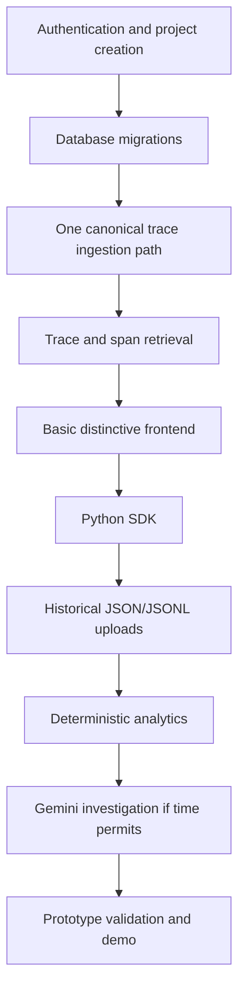

# Implementation Plan

**Status:** This is a **PROPOSED** roadmap, not a schedule guarantee. The approximately 30 focused hours (one hour/day for a month) target a demonstrable prototype/MVP, not a fully production-hardened observability platform. Revisit estimates after the first implementation session.

## Delivery target and priority (not product scope)

All capabilities listed in [MVP Scope](MVP_SCOPE.md) remain in the approved product scope. This ordered list is a delivery priority under the time constraint, not a removal or reclassification of MVP capabilities:

1. Authentication and project creation.
2. Database migrations.
3. One canonical trace ingestion path.
4. Trace and span retrieval.
5. A basic but distinctive frontend.
6. Python SDK.
7. Historical uploads.
8. Deterministic analytics.
9. Gemini investigation if the remaining time permits.

The first ingestion path should be a minimal server/API path over the canonical schema; it establishes the working vertical slice before SDK and file adapters. Gemini remains an MVP capability, but its implementation is last-priority and may be deferred if the prototype time budget is exhausted. This constraint does not imply production readiness; hardening, operational reliability, retention, recovery, and scale targets need separate time and decisions.

## Dependency overview

## Phases and exit evidence

| Phase | Work | Exit evidence |
|---|---|---|
| 1. Identity and schema foundation | Authentication, single-owner project creation, PostgreSQL configuration, migrations, project/API-key authorization | Local DB migrates cleanly; ownership and key-security tests |
| 2. Canonical trace path | One bounded ingestion path, canonical schema, validation and persistence | A synthetic trace with spans can be persisted through one route |
| 3. Retrieval and interface | Trace/span read APIs; basic, distinctive frontend with trace-focused design | User can find and inspect a real synthetic trace and span hierarchy |
| 4. SDK and historical adapters | Python manual instrumentation, then JSON/JSONL uploads through the shared pipeline | SDK and uploads converge on the same canonical record semantics |
| 5. Deterministic analytics | Volume, latency, errors, tokens, cost availability, basic insights | Fixture metrics reconcile; unknown cost remains unavailable |
| 6. Gemini investigation (if time permits) | Explicit invocation, privacy/evidence selection, validation, report history | Investigation is evidence-backed and absent from routine paths |
| 7. Prototype validation | Focused integration/security checks, local demo and deployment notes | Repeatable prototype demonstration; remaining production gaps documented |

Dependencies: ingestion requires schema/auth/migrations; retrieval and the interface require persisted traces; SDK and upload adapters depend on the working canonical path; analytics requires usable persisted telemetry; investigation depends on telemetry/metrics and may be deferred. Deployment depends on configuration, migrations, and security decisions.

## One-month prioritization proposal

Treat scope as a sequence of thin vertical slices, not a production release train. The target is a demonstrable prototype/MVP in approximately 30 focused hours, not a fully production-hardened observability platform. First make identity, migrations, and a minimal canonical trace ingest/read path work; add the basic distinctive UI; then broaden to SDK and upload adapters and deterministic analytics. Attempt Gemini only if the remaining time permits. Every week should end with a runnable state and a short demo.

Suggested allocation (revisit after actual progress): identity/schema and first ingestion/read path 12h; basic distinctive frontend 5h; SDK and historical upload adapters 5h; deterministic analytics 3h; prototype validation/demo 3h; Gemini investigation up to 2h only if earlier priorities are complete. This totals approximately 30 hours and is a prototype tradeoff, not production-hardening capacity. Security, tests, and documentation are continuous rather than deferred.

## Risk controls and scope cuts

- **Scope/time risk:** cut visual polish and advanced filters before core isolation or ingestion correctness.
- **Data-contract risk:** finalize batch atomicity, IDs/idempotency, limits, and timestamp semantics before shipping SDK.
- **AI/privacy risk:** defer Gemini until consent, evidence selection, redaction, token budget, and failure handling are tested.
- **Deployment risk:** this time budget does not establish production readiness; select a target and retention policy and budget separate hardening work before any production claim.
- **Upload risk:** keep synchronous limits conservative; do not add queues absent measured need.

## First implementation task after documentation review

Recommended: create the minimal runnable backend/database foundation for authentication, single-owner project creation, and PostgreSQL migrations, then implement one canonical trace ingestion and retrieval path. This directly advances the top delivery priorities. Before coding, settle the API-key/JWT basics and the batch idempotency schema decision; do not begin with Gemini or infrastructure expansion.
