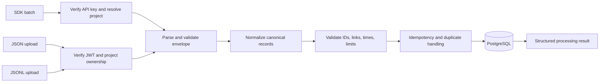

# Shared Ingestion Pipeline

**Status:** SDK and JSON/JSONL must converge on one canonical pipeline (**CONFIRMED**). Detailed synchronous transaction and partial-failure policies below are proposals and remain subject to validation.

## Goal

Accept telemetry from:

1. Python SDK batch requests authenticated by a project API key.
2. Historical JSON upload authenticated by dashboard JWT and project ownership.
3. Historical JSONL upload under the same dashboard authorization.

Each adapter parses its transport into canonical trace/span/event inputs, then calls the same validation, normalization, relationship, idempotency, and persistence service. There is one schema, storage system, and analytics path.

## Processing stages

1. **Transport limits:** enforce body/file, record-count, nesting, string, and JSON depth/size bounds before expensive processing.
2. **Authentication/project resolution:** verify SDK key, resolve project from key record; for uploads, verify user JWT and ownership of URL project.
3. **Parsing:** accept supported JSON envelope or JSONL records. Reject malformed encoding, invalid JSON, unsupported formats, and excessive lines.
4. **Schema/version validation:** require a supported schema version; reject unsupported future versions clearly. Version migration/compatibility policy must be explicit.
5. **Normalization:** map source representations to canonical UUID/timestamp/attribute/status conventions. Do not infer missing sensitive information or silently fabricate required values.
6. **Referential integrity:** resolve trace, span, parent, and event links within batch or existing same-project data. Reject cross-trace/project references and cycles.
7. **Semantic validation:** enforce nonnegative durations/tokens, valid time order, extensible operation values, and optional provider/model fields.
8. **Idempotency:** apply only the project-scoped policy approved for the schema. Durable batch-level replay/conflict handling is not provided by the confirmed eight-table design; do not claim it until a persistent mechanism is approved.
9. **Persistence:** use a transaction where practical to preserve relationships. Upload metadata/status is recorded in `uploads`; the DB is initially the telemetry system of record.
10. **Result:** return sanitized counts and record-level or batch-level errors without secrets. Do not claim successful persistence when it failed.

## Shared behavior and source differences

| Concern | SDK | Historical upload |
|---|---|---|
| Authentication | Project API key | User JWT |
| Project source | Server-resolved from key | URL project, owner-checked |
| Transport | Bounded JSON batch | JSON or JSONL file/body |
| Pipeline after auth/parse | Same canonical validator and persistence | Same canonical validator and persistence |
| Response | Batch acceptance/idempotency | Upload processing status/summary |

An SDK-supplied `project_id` is not authoritative. Historical uploads are not allowed to bypass owner checks.

## Batch and partial failure policy

**PROPOSED:** process reasonably sized uploads synchronously in the MVP and reject over-limit requests with a clear size/count error. Avoid background queues absent a demonstrated requirement.

**UNRESOLVED:** whether a batch is all-or-nothing or supports partial record acceptance. Prefer atomic per batch for referential integrity and predictable retries; if partial acceptance is chosen, response must identify accepted/rejected records and retry semantics must prevent duplicates. Decide and test before freezing the endpoint. Atomic telemetry writes alone do not provide durable batch replay detection: the idempotency key and payload fingerprint also need persistent storage.

Limits must be configurable/documented and based on measured PostgreSQL/request behavior. There are no approved numeric limits yet.

## Idempotency and duplicates

The SDK envelope is proposed to contain `schema_version` and `batch_id`, but a field in a request is not durable idempotency by itself. The current eight-table schema has no SDK batch ledger, so exact replay detection, payload-fingerprint comparison, and batch-level outcome recovery cannot be guaranteed by it.

### Options and recommendation (PROPOSED / UNRESOLVED)

| Option | What it provides | Limitations |
|---|---|---|
| **A. Proposed ninth `ingestion_batches` table** | Unique `(project_id, batch_id)` plus a payload fingerprint and processing status/counts can distinguish an identical replay from changed-content reuse, persist an outcome, and cover empty batches | Requires project-owner approval to change the confirmed eight-table design; transaction/concurrency, retention, and partial-result detail still need finalization |
| **B. Record-level stable IDs within the eight tables** | Stable project-scoped trace/span/event IDs can make repeated record inserts idempotent and avoid an extra table | Cannot identify an empty-batch replay or determine that all records from a batch were previously accepted; partial batches and same-ID/different-content conflicts need a separate policy |
| **C. Reuse `uploads` or project JSONB** | Avoids a new named table | `uploads` conflates file submissions with SDK batches; JSONB markers have poor uniqueness, concurrency, growth, and retention characteristics. Neither is recommended |

**Recommendation:** A is the cleanest durable batch-level solution. Proposed ledger fields are `id`, `project_id`, `batch_id`, `payload_fingerprint`, `processing_status`, `accepted_count`, `rejected_count`, `created_at`, and `completed_at`, with unique `(project_id, batch_id)`. Under an all-or-nothing policy, ledger completion and telemetry writes should commit atomically; concurrent replays should resolve to the committed result or an explicit in-progress state. Partial acceptance requires enough persisted outcome detail to make retries safe. This is a proposal only; **the ninth table is not approved and must not be treated as part of the confirmed schema**.

Until approved, the eight-table fallback is record-level stable IDs, explicitly with the limitations above. Scope of IDs, retention, fingerprint canonicalization, duplicate conflict response, and outcome replay are unresolved. Do not promise durable batch-level idempotency without owner approval and corresponding persistence/tests.

## Upload processing status

The MVP's synchronous path may transition a metadata record through `received` → `processing` → `completed` or `failed`, even if transitions are brief. Status and sanitized error summary must reflect actual persisted outcome. Do not require external object storage: initially record metadata, not assume durable raw-file retention. Temporary file staging and cleanup are unresolved; keep contents out of logs.

## Failure behavior

- Invalid JSON/schema/relationships: reject with structured validation details safe for the caller.
- Unsupported schema version: explicit unsupported-version error.
- Unauthorized project/key: deny without exposing whether another project's records exist.
- Payload too large: reject before full parse/persistence.
- Conflicting idempotency replay: explicit conflict only if the approved persistence design can detect it; otherwise do not claim batch-level conflict detection.
- Database failure: rollback according to chosen transaction policy, return server failure, and permit safe retry.
- Partial failure (if adopted): report per-record status; do not disguise as complete success.
- Unexpected errors: log correlation ID and sanitized diagnostic server-side; never include secrets in client error.

## Tests required

Equivalent SDK/JSON/JSONL fixtures normalize to equivalent canonical records; malformed/oversized input; future schema; timestamp and count constraints; missing/cross-project parents; cycles; approved idempotency behavior (batch replay/fingerprint/conflict if a ledger is approved, or record-level replay and documented limitations if it is not); transaction rollback; upload ownership; accurate processing status; and privacy-safe errors/logs. Do not write tests that assert durable batch-level replay until an approved schema/persistence design supports it.

See [API Contracts](API_CONTRACTS.md), [Telemetry Schema](TELEMETRY_SCHEMA.md), and [Database Schema](DATABASE_SCHEMA.md).
