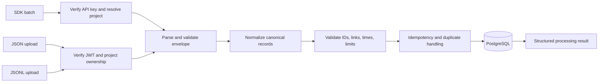

# Shared Ingestion Pipeline

**Status:** SDK and JSON/JSONL convergence, synchronous bounded processing, atomic all-or-nothing batches, and record-level idempotency using stable trace/span/event identifiers are **CONFIRMED**. Exactly eight initial logical database tables are approved; no `ingestion_batches` table is permitted. See [ADR 007](decisions/007-atomic-ingestion-and-record-level-idempotency.md).

## Goal

Accept telemetry from:

1. Python SDK batch requests authenticated by a project API key.
2. Historical JSON upload authenticated by dashboard JWT and project ownership.
3. Historical JSONL upload under the same dashboard authorization.

Each adapter parses its transport into canonical trace/span/event inputs, then calls the same validation, normalization, relationship, idempotency, and persistence service. There is one schema, storage system, and analytics path.

## Processing stages

1. **Transport limits:** enforce body/file, record-count, nesting, string, and JSON depth/size bounds before expensive processing.
2. **Authentication/project resolution:** verify SDK key, resolve project from key record; for uploads, verify user JWT and ownership of URL project.
3. **Parsing:** accept supported JSON envelope or JSONL records. Reject malformed encoding, invalid JSON, unsupported formats, and excessive lines.
4. **Schema/version validation:** require a supported schema version; reject unsupported future versions clearly. Version migration/compatibility policy must be explicit.
5. **Normalization:** map source representations to canonical UUID/timestamp/attribute/status conventions. Do not infer missing sensitive information or silently fabricate required values.
6. **Referential integrity:** resolve trace, span, parent, and event links within batch or existing same-project data. Reject cross-trace/project references and cycles.
7. **Semantic validation:** enforce nonnegative durations/tokens, valid time order, extensible operation values, and optional provider/model fields.
8. **Idempotency:** use the stable UUID of each trace, span, and event as its record identity. Existing ID plus identical canonical content is a duplicate/no-op; existing ID plus different content is a conflict. `batch_id` may correlate a request but is not persisted as an idempotency key.
9. **Persistence:** after validating the entire batch, write all new records in one transaction. Any failure rolls back every write. Upload metadata/status is recorded in `uploads`; the DB is the telemetry system of record.
10. **Result:** return sanitized counts for accepted and identical duplicate records after commit, or a structured error for a rejected batch. Never report partial acceptance or success before commit.

## Shared behavior and source differences

| Concern | SDK | Historical upload |
|---|---|---|
| Authentication | Project API key | User JWT |
| Project source | Server-resolved from key | URL project, owner-checked |
| Transport | Bounded JSON batch | JSON or JSONL file/body |
| Pipeline after auth/parse | Same canonical validator and persistence | Same canonical validator and persistence |
| Response | Batch acceptance/idempotency | Upload processing status/summary |

An SDK-supplied `project_id` is not authoritative. Historical uploads are not allowed to bypass owner checks.

## Batch and failure policy

**PROPOSED:** process reasonably sized uploads synchronously in the MVP and reject over-limit requests with a clear size/count error. Avoid background queues absent a demonstrated requirement.

**CONFIRMED:** process each batch atomically, all-or-nothing. The complete input must pass parsing, schema, semantic, and relationship validation before inserts begin. Persist the batch's new records in one transaction; duplicate records with identical canonical content are no-ops, but conflicting reuse of any trace/span/event ID rejects the entire batch and rolls back all new records in it. There is no partial success mode.

Limits must be configurable/documented and based on measured PostgreSQL/request behavior. There are no approved numeric limits yet.

## Record-level idempotency

Use client-stable UUIDs already present on canonical trace/span/event records; do not add an idempotency table or other ninth logical table. For each existing ID, compare normalized canonical content: identical content counts as duplicate/no-op; different content is a conflict. The conflict invalidates and rolls back the entire incoming batch. Enforce IDs with database uniqueness and handle concurrent inserts by catching the resulting integrity conflict, rolling back, and determining/retrying only under the same canonical comparison rules.

This policy makes telemetry inserts idempotent by record, not by request. It cannot retrieve a prior batch response, detect a repeated empty batch, or distinguish two batch envelopes containing the same record set. A supplied `batch_id` is correlation metadata only and has no persisted uniqueness or fingerprint. These limitations are accepted to preserve the exactly-eight-table schema.

## Upload processing status

The MVP's synchronous path may transition a metadata record through `received` → `processing` → `completed` or `failed`, even if transitions are brief. Status and sanitized error summary must reflect actual persisted outcome. Do not require external object storage: initially record metadata, not assume durable raw-file retention. Temporary file staging and cleanup are unresolved; keep contents out of logs.

## Failure behavior

- Invalid JSON/schema/relationships: reject with structured validation details safe for the caller.
- Unsupported schema version: explicit unsupported-version error.
- Unauthorized project/key: deny without exposing whether another project's records exist.
- Payload too large: reject before full parse/persistence.
- Same record IDs and identical canonical content: treat as duplicate/no-op.
- Same record ID with different canonical content: reject the whole batch with a conflict; no rows from that batch are committed.
- Database failure or any invalid record: roll back the whole batch and return a sanitized error; a retry is safe under the stable-ID duplicate rules.
- Unexpected errors: log correlation ID and sanitized diagnostic server-side; never include secrets in client error.

## Tests required

Equivalent SDK/JSON/JSONL fixtures normalize to equivalent canonical records; malformed/oversized input; future schema; timestamp and count constraints; missing/cross-project parents; cycles; identical stable-ID replay; conflicting same-ID content; atomic rollback when one record conflicts or fails validation; concurrent duplicate insertion; upload ownership; accurate processing status; and privacy-safe errors/logs. Do not test batch-ID deduplication or batch-outcome recovery: no batch ledger exists.

See [API Contracts](API_CONTRACTS.md), [Telemetry Schema](TELEMETRY_SCHEMA.md), and [Database Schema](DATABASE_SCHEMA.md).
