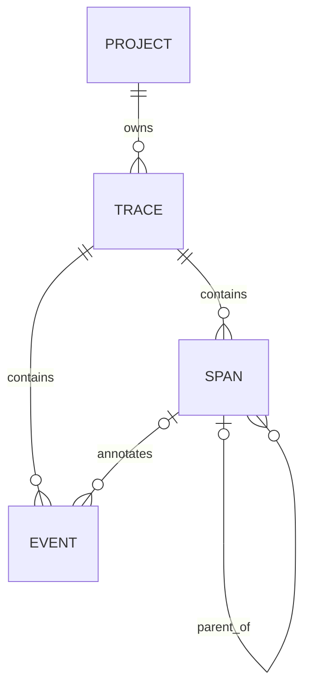

# Canonical Telemetry Schema

**Status:** Trace/span/event concepts and UUID, UTC, JSONB, monotonic-duration requirements are **CONFIRMED**. Field naming, ingestion envelope details, and some semantics below are **PROPOSED** and require implementation validation.

## Concepts

- **Trace:** one complete application request or workflow. Contains spans and events.
- **Span:** one operation within a trace; may be nested below another span.
- **Event:** an occurrence associated with a trace and optionally a span.
- **Project:** isolated workspace that owns telemetry.

## Proposed canonical fields

All persisted identifiers are UUIDs. Timestamps are UTC instants and PostgreSQL `TIMESTAMPTZ`; extensible attributes are JSON objects stored as JSONB. Client payloads must not be trusted for project authorization.

### Trace

| Field | Type | Meaning |
|---|---|---|
| `id` | UUID | EvalForge canonical identifier |
| `project_id` | UUID | Owning project |
| `external_id` | optional string | Source-system identifier, scoped to project if uniqueness is enforced |
| `name` | string | Workflow/request name |
| `status` | extensible string | Proposed derived outcome or explicit override |
| `start_time`, `end_time` | UTC timestamp | Observed trace boundaries |
| `duration_ms` | nonnegative integer/bigint | Elapsed trace duration |
| `environment`, `service_name` | optional string | Source context |
| `attributes` | JSON object | Extensible non-sensitive metadata |
| `created_at` | UTC timestamp | Server persistence time |

Trace duration is the elapsed whole-workflow interval, not the sum of child span durations; parallel spans may overlap, and gaps may exist. Status should be derived from span outcomes unless an explicit override is supplied. The precedence and allowed status vocabulary are **UNRESOLVED**.

### Span

| Field | Type | Meaning |
|---|---|---|
| `id` | UUID | Canonical span ID |
| `project_id`, `trace_id` | UUID | Project and owning trace |
| `parent_span_id` | optional UUID | Parent span in the same trace; null for root |
| `name` | string | Operation label |
| `operation_type` | extensible string | e.g. `llm`, `tool`, `retrieval`, `database`, `http`, `function` |
| `status` | extensible string | Operation outcome |
| `start_time`, `end_time` | UTC timestamp | Wall-clock boundaries |
| `duration_ms` | nonnegative integer/bigint | Elapsed operation duration |
| `provider`, `model` | optional string | Provider/model metadata |
| `input_tokens`, `output_tokens`, `total_tokens` | optional nonnegative integer/bigint | Usage where known |
| `estimated_cost` | optional fixed-precision numeric | Backend-calculated estimate in the proposed canonical reporting currency |
| `estimated_cost_currency` | optional ISO 4217 code | Currency for the estimate; paired with `estimated_cost` |
| `attributes` | JSON object | Extensible metadata subject to redaction |
| `error_type`, `error_message` | optional string | Sanitized failure details |
| `created_at` | UTC timestamp | Server persistence time |

Provider, model, and usage fields are optional; generic Python operations are first-class. Token fields may be unknown independently. Whether total is stored, derived, or reconciled when inconsistent is **UNRESOLVED**. Client estimated cost is untrusted and must not determine backend analytics.

### Cost currency (PROPOSED / UNRESOLVED)

The backend should calculate cost from its configured provider/model pricing rather than trusting client-supplied estimates. Proposed canonical representation is a fixed-precision decimal amount plus an explicit three-letter ISO 4217 `estimated_cost_currency`; the two values are either both present or both null. The preferred reporting approach is to normalize all known estimates to one canonical reporting currency. USD is a candidate, not an approved choice. No pricing catalog, exchange-rate source, conversion timing, or rounding policy is specified here; do not imply that cross-currency conversion exists until those decisions are made.

If pricing is unknown, both cost and currency are null (unavailable), not zero. Analytics may sum only values in the same known reporting currency; display the currency code with totals and format according to locale without losing the underlying currency/code. Mixed currencies must not be added or shown as one unlabeled total. The canonical currency and conversion rules require project-owner approval.

### Event

| Field | Type | Meaning |
|---|---|---|
| `id` | UUID | Canonical event ID |
| `project_id`, `trace_id` | UUID | Project and owning trace |
| `span_id` | optional UUID | Related span, if any |
| `event_type` | extensible string | e.g. error, retry, warning, custom |
| `name` | string | Short event label |
| `timestamp` | UTC timestamp | Occurrence time |
| `message` | optional string | Redacted/sanitized description |
| `attributes` | JSON object | Extensible metadata |
| `created_at` | UTC timestamp | Server persistence time |

## Time and duration rules

- SDK captures start/end instants in UTC for event correlation and measures elapsed time using a monotonic clock, avoiding wall-clock jumps.
- Persisted timestamps are timezone-aware UTC instants. Reject or normalize offset timestamps explicitly; never silently interpret naive local time as UTC.
- Duration is elapsed time, nonnegative, and ideally computed from monotonic elapsed measurement at the SDK. Uploaded durations must be validated against policy; server recomputation may be impossible when clock origins differ.
- End before start, negative duration, and impossible relationships are invalid. Tolerance for timestamp skew and derived-duration reconciliation is **UNRESOLVED**.

## Integrity and idempotency

IDs must be unique within the relevant project namespace and relationships must be validated before persistence. A span parent must exist in the same trace/project; event references must resolve to a trace and, if supplied, a span in that trace/project. Composite project-aware foreign keys are proposed; see [Database Schema](DATABASE_SCHEMA.md).

Trace, span, and event UUIDs are stable record identities for idempotent ingestion. The confirmed eight-table schema does not persist batch IDs or batch fingerprints; there is no `ingestion_batches` table. Within an atomic batch, an existing record ID with identical canonical content is a duplicate/no-op; an ID with different content conflicts and rejects the whole batch. A `batch_id`, if supplied, is correlation metadata only. Empty-batch replay and batch-outcome retrieval are not supported. See [Database Schema](DATABASE_SCHEMA.md), [Ingestion Pipeline](INGESTION_PIPELINE.md), and [ADR 007](decisions/007-atomic-ingestion-and-record-level-idempotency.md).

## Validation

- UUID syntax, schema version, required fields and bounded strings.
- Nonnegative duration and token values; valid timestamps.
- JSON object attributes with size/depth limits.
- Referential integrity and project consistency.
- Unknown operation/event/status values remain representable; avoid rigid enums.
- Sensitive prompt/response payload capture is off by default; see [Security](SECURITY.md).

Detailed field wire format is intentionally not finalized; API examples are illustrative, not a frozen compatibility contract.
